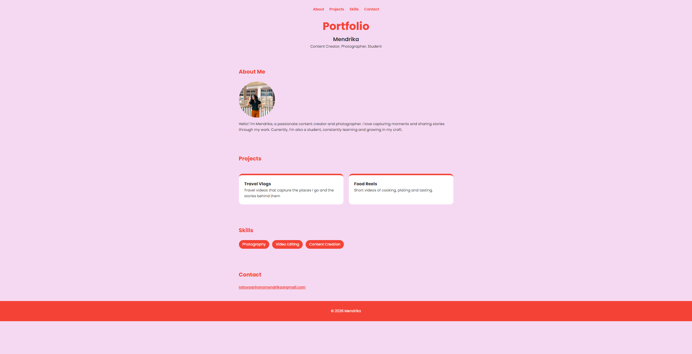
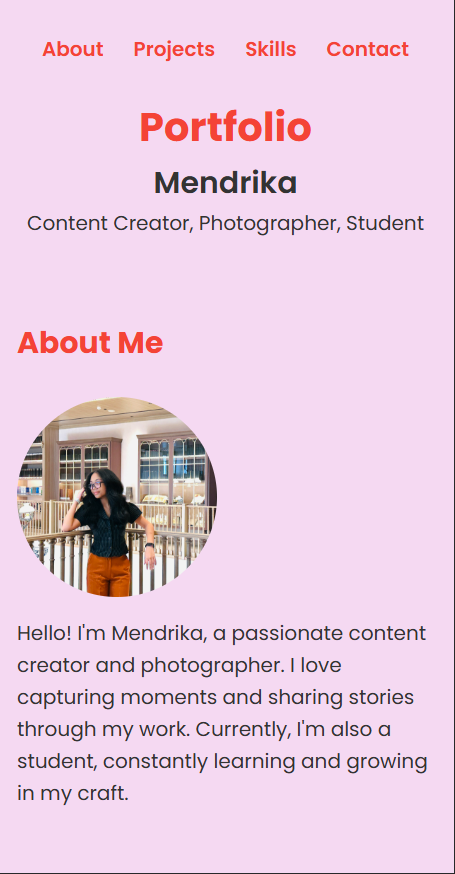
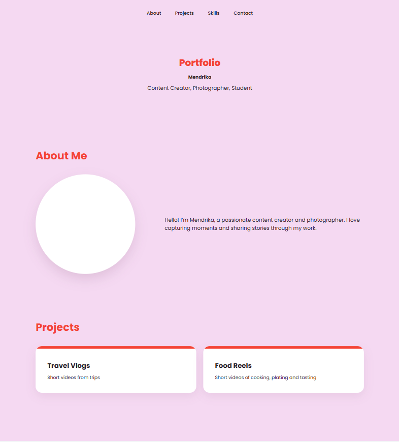

# 🌐 Personal Portfolio Website

## 📖 Project Overview
This is a single-page responsive portfolio website created as part of the lab assignment (WEEK06 HCI LAB). It showcases my profile, projects, skills, and contact details, as a student, content creator and photographer. It is built using HTML and CSS only (no JavaScript).

* URL Link to website portfolio: [Click Here](https://mendrika30.github.io/portfolio/)
* URL Link to website design: [Click Here](https://canva.link/43nv2ngix69nixt)

## 🎯 Purpose
The goal of this project is to:

* Practice responsive web design techniques
* Learn how to structure and style a webpage
* Showcase my content creation projects in a clear, professional format

## 👥 Target Audience
This portfolio is designed for:

* [✅] Potential employers or recruiters
* [✅] Lecturers and academic supervisors
* [✅] Freelance and collaboration opportunities

Note: the projects are sample projects created for this assignment.

## 🧱 Technologies Used

* HTML5 (semantic elements: header, nav, main, section, article, footer)
* CSS3 (Flexbox, box model, transitions, media queries)
* Google Fonts (Poppins)

## 📐 Layout & Sections
The website includes the following sections:

* Header: title, name, and tagline
* About Me: short bio and photo
* Projects: Travel Vlogs and Food Reels
* Skills: Photography, Video Editing, Content Creation
* Contact: email link
* Footer: copyright

## 📱 Responsiveness
The site is optimized for:

* Desktop
* Tablet
* Mobile

Responsive design is achieved using media queries, relative units (em, %), and flexible Flexbox layouts that wrap on smaller screens.

## 🧪 How to Run Locally

1. Open your code editor (e.g., Visual Studio Code).
2. Clone the repository:

       git clone https://github.com/Mendrika30/portfolio.git

3. Open `index.html` in your browser, or run it with the Live Server extension.

## 📂 Folder Structure

    portfolio/
    │
    ├── index.html
    ├── style.css
    ├── images/
    └── README.md

## 📄 Notes

* I used Claude (AI) to help me plan the layout, get HTML and CSS snippets, and fix CSS bugs.
* I designed the layout and color scheme in Canva, and I customized the content, text, and styling myself.
* I wrote the project descriptions and contact section myself.

## 📸 Screenshots

### Desktop

### Mobile

### Design (Canva)

